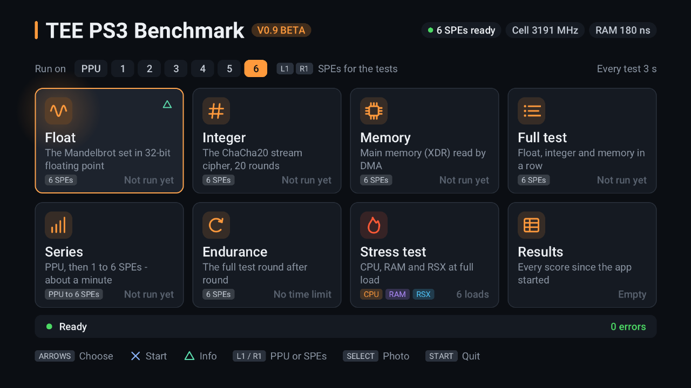
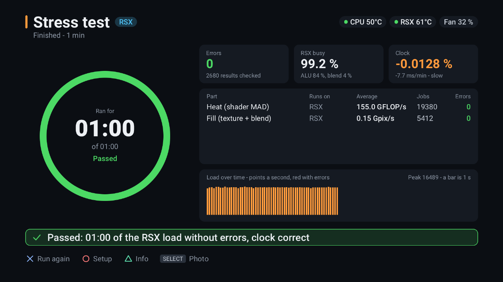

# TEE PS3 Benchmark

A benchmark and full-load stress test for the PlayStation 3, written in C with the open-source
[PSL1GHT](https://github.com/ps3dev/PSL1GHT) SDK. It loads the Cell's PPU and all six SPEs, the RAM and
the RSX graphics chip – and checks every single result.



## Features

**Benchmarks** on the PPU or on 1 to 6 SPEs, 3 seconds each:

| Test | What runs |
|---|---|
| Float | The Mandelbrot set in 32-bit floating point |
| Integer | The ChaCha20 stream cipher, 20 rounds |
| Memory | Main memory (XDR) read by DMA |
| Full test | Float, integer and memory in a row |
| Series | The full test on the PPU, then on 1 to 6 SPEs (about a minute) |
| Endurance | The full test round after round, until stopped |
| Results | Every score since the app started |

**Stress test** with six loads and a duration from 20 s to endless:

| Load | What runs |
|---|---|
| Mixed | 2 SPEs each on Mandelbrot, ChaCha20 and memory, both PPU threads |
| CPU max | Every SPE issues a fused multiply-add and a shuffle in every cycle; both PPU threads run a VMX heat kernel |
| CPU + RAM | CPU max while the SPEs' DMA units write the RAM and read it back |
| RSX | The graphics chip alone |
| CPU + RSX | CPU max and the RSX load together |
| Everything | CPU, RAM and RSX at once – the whole console |

The **RSX load**:
- A pixel shader of multiply-adds, in the fastest of four register layouts (about 97 % of the RSX's arithmetic peak on its own).
- Full-screen layers that read a 16 MB texture, compute and blend. They go into a tiled render target when that is faster. The number of multiply-adds per pixel is chosen at start, so that the arithmetic units and the blending are busiest together.
- An optional vertex load. It is only used when it really runs alongside the pixels.
- A VRAM read-back check.

**Pacing by the RSX's own clock.** While the RSX load runs, a picture stays for two TV frames. The load is set from the RSX's own time stamps, so that the RSX reaches the next flip a fraction of a millisecond before the vertical blank. A stock PS3 shows about 99 % RSX busy, measured, not estimated.

**Everything is checked:**
- Reference checksums for every job.
- Bit-exact check tiles for the shader, the fill and the vertices; one pixel of each is also recomputed on the PPU.
- RAM patterns checked byte for byte.
- The VRAM compared with what the PPU wrote.

An error turns the screen red and goes into the log.

**Live data:**
- Throughput and history for each part.
- SPU busy, RSX busy and the share of each RSX unit.
- The Cell clock, measured by the SPEs.
- RAM latency.
- The timer against an NTP time server.
- CPU and RSX temperatures and the fan speed via webMAN MOD.

**Safety:**
- The app never changes a clock or the fan, and never touches `dev_flash`.
- The stress test stops at 85 °C (CPU or RSX).
- Every new kind of RSX work goes through a self-test first. If the RSX does not answer, the app ends instead of leaving a hung graphics chip behind.



## Requirements

- A PlayStation 3 that runs homebrew (custom firmware or HEN). Developed and tested on a PS3 with custom firmware 4.9x.
- Optional: [webMAN MOD](https://github.com/aldostools/webMAN-MOD), for the temperatures, the fan speed and the on-screen notifications.
- Optional: a network connection, for the clock check against `pool.ntp.org`.

## Install

1. Download `TEE-PS3-Benchmark.pkg` from the [Releases](../../releases) page.
2. Copy it to the PS3, for example to `/dev_hdd0/packages/` over FTP, or onto a USB stick.
3. Install it with *Package Manager → Install Package Files*.

The log of every start (`bench-YYYYMMDD-HHMMSS.log`) and the screenshots taken with SELECT (PPM, 1280x720) are written to `/dev_hdd0/tmp/teebench/`.

## Controls

| Where | Buttons |
|---|---|
| Menu | Arrows choose, ✕ starts, △ opens the info page, L1/R1 pick the PPU or 1–6 SPEs, SELECT takes a photo, START quits |
| Stress test setup | L1/R1 set the duration, arrows choose the load, ✕ starts, ○ goes back |
| Running test | ○ cancels, △ shows the info page |

## Building

You need a PSL1GHT toolchain ([ps3toolchain](https://github.com/ps3dev/ps3toolchain)) built with GCC 13 in `$PS3DEV`, which defaults to `~/ps3dev`. A build made with an older GCC 7.2 toolchain hung the console at start.

```bash
./build.sh pkg      # builds tee-ps3-benchmark.pkg
./build.sh clean
```

`build.sh` copies the sources to `/tmp/ps3-benchmark-build`, so paths with spaces work, builds there, and copies the package back.

Generated files are in the repository, so the build needs no other tools. To make them again:

| Tool | Makes |
|---|---|
| `tools/make_font_atlas.swift` | `data/ui_atlas.bin` and `source/ui_atlas.c`, from the Roboto fonts (macOS, Swift) |
| `tools/make_xmb_images.swift` | `assets/ICON0.PNG` and `pkgfiles/PIC1.PNG` (macOS, Swift) |
| `tools/make_vload.py` | `shaders/vload.vasm`, the vertex load program |
| `tools/pace_sim.c` | Tries the RSX pacing (`source/rsx_pace.c`) against a simulated RSX on a computer |

`./build.sh pkg AUTOTEST=1` builds a version that presses its own buttons, for the RPCS3 emulator. It expects stand-ins for webMAN on `127.0.0.1:18080` and for the time server on `127.0.0.1:12300`; they are not included. In an emulator the timings mean nothing, but the checks, the self-tests and the screenshots do.

[docs/PSL1GHT-NOTES.md](docs/PSL1GHT-NOTES.md) lists the PSL1GHT and RSX pitfalls found while writing this app.

## Credits and licences

- Code: [MIT](LICENSE), © 2026 TheErsysEnding (TEE).
- Font: [Roboto](https://fonts.google.com/specimen/Roboto), © 2011 Google Inc., under the [Apache License 2.0](fonts/LICENSE). The app shows it as a texture atlas made from these files.
- Built with [PSL1GHT](https://github.com/ps3dev/PSL1GHT) (MIT), which is not included here. The interface's "texture × colour" fragment program follows *tiny3d* by Hermes.
- Tested with the [RPCS3](https://rpcs3.net) emulator, and on real hardware. The screenshots are from a PS3; in an emulator the clock, latency and RSX figures describe the host computer, not a PS3.

PlayStation and PS3 are trademarks of Sony Interactive Entertainment. This project is not affiliated with or endorsed by Sony.

**Use at your own risk.** A full-load stress test heats the console. Make sure it can breathe, and keep an eye on the temperatures. The software comes without any warranty (see [LICENSE](LICENSE)).
